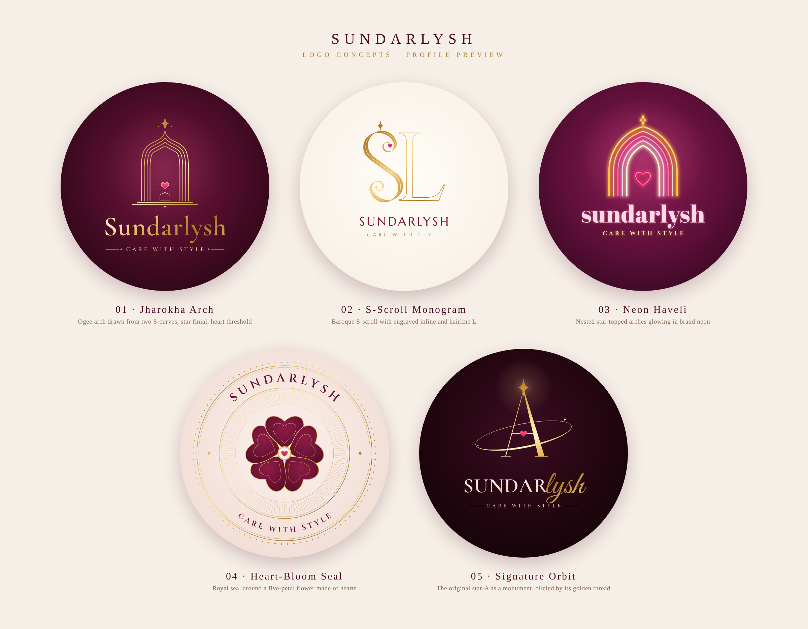

# Sundarlysh: Logo Concepts

Five profile-logo concepts for **Sundarlysh: Care With Style**, based on the
original mark (wine "SUNDAR", gold script "lysh", a star-topped **A** with a
pink heart on its crossbar, and a golden thread swoosh). The Instagram
references guided the direction: Akasa, Confetti n Bloom and The Wedding Design
Company.



| # | Concept | Reference | Idea |
|---|---------|-----------|------|
| 01 | **Jharokha Arch** | Akasa | A Mughal *jharokha* (window arch) drawn in nested gold lines. Each side of the arch is an **ogee**, which is an S-curve, so the doorway is made from two mirrored S's. The brand star sits at the tip, and the heart on its crossbar repeats the "A" from the original logo. |
| 02 | **S-Scroll Monogram** | WDC | The **S** is a baroque *S-scroll* drawn like a broad-nib pen stroke, with an engraved inline. It sits over a hairline-outlined **L** (Sundar · lysh). The pink heart rests in the top curl, where WDC has its red drop. |
| 03 | **Neon Haveli** | Confetti n Bloom | Nested star-topped arches glow as neon tubes in brand colours (gold → peach → rose → blush → champagne), with a neon heart at the threshold. |
| 04 | **Heart-Bloom Seal** | Classic seal | A royal seal with a beaded edge and curved lettering. In the centre, five **heart-shaped petals** form a flower around a pink heart. The flower stands for care, growing into beauty. |
| 05 | **Signature Orbit** | Original logo | The star-topped **A** from the current logo stands tall, and the original golden thread circles it like an orbit. The "SUNDAR" + script "lysh" lockup is kept, so the new mark stays recognisable. |

## Files

```
svg/   01-jharokha-arch.svg … 05-signature-orbit.svg   (vector, 1080×1080, all text outlined)
png/   01-jharokha-arch.png … 05-signature-orbit.png   (2160×2160, ready for Instagram DP)
sundarlysh-concepts-board.png                          (presentation board, circle-crop preview)
src/   generator scripts (Node + opentype.js + Playwright)
```

* Every SVG is fully vector, with **all text converted to outlines**. The files
  open the same everywhere (Illustrator, Figma, Inkscape, browsers) without
  installing fonts.
* Each design is square with a full-bleed background. All content sits inside
  the centre circle, so it survives Instagram/WhatsApp circular cropping.

## Palette

| Role | Hex |
|------|-----|
| Deep wine | `#4E0D29` / `#6B0F33` |
| Gold (metallic gradient) | `#8A5A14` → `#F6D98C` → `#FFF3C4` → `#A9741F` |
| Heart pink | `#FF5C86` → `#D3134A` |
| Ivory / blush | `#FBF7F0` / `#F6E7E1` |

## Fonts (all SIL Open Font License, free for commercial use)

Cormorant Garamond, Cinzel, Marcellus, Abril Fatface, Great Vibes.

## Regenerate / edit

```bash
cd src
npm install
node build.js            # writes out/*.svg
node render.js out 2 out/*.svg   # PNGs at 2160px
```

Each concept is its own file (`c1_arch.js` … `c5_signature.js`). Colours,
sizes and spacing are plain numbers at the top of each `build()` function.
