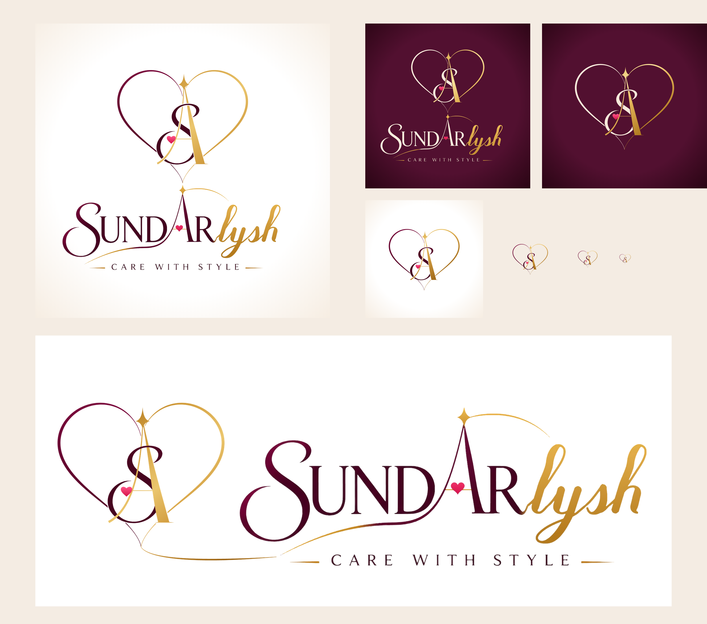

# Sundarlysh: Logo



## The logo

**The mark:** a **heart** drawn by the brand's thread, with a **wine half
(Sundar)** and a **gold half (lysh)**. Inside it, the **S** from the wordmark
is woven through the **star-A**. The pink heart sits on the A's crossbar, and
the A's star rises out of the heart's top dip.

**Joined to the text:**
* **Stacked logo:** the mark sits on top, and its heart's tip runs straight
  into the **star of the A** in SUNDARlysh. The mark and the name read as one
  connected piece.
* **Horizontal logo:** the mark sits on the left, and the heart's thread runs
  on and becomes the **gold swoosh under SUND**.

The wordmark is the client's original lettering, traced to vector, not retyped.

## Which file to use

| Use | File |
|-----|------|
| Instagram / WhatsApp profile picture | `png/sundarlysh-logo.png` (with name) or `png/sundarlysh-logomark-instagram-1080.png` (mark only) |
| Dark backgrounds / posts | `png/sundarlysh-logo-dark.png`, `png/sundarlysh-logomark-dark.png` |
| Print, packaging, labels, on photos (no background) | `png/sundarlysh-logo-transparent.png`, `png/sundarlysh-logomark-transparent.png` |
| Same, on dark colours | `png/sundarlysh-logo-transparent-for-dark-bg.png` |
| Website header, letterhead, visiting card, shop board | `png/sundarlysh-logo-horizontal.png` (transparent) |
| Same, on dark colours | `png/sundarlysh-logo-horizontal-for-dark-bg.png` |
| Favicon / app icon / stamp | `png/sundarlysh-logomark-512.png` |
| Printers / designers (any size) | everything in `svg/` |

Square PNGs are 2160×2160. Horizontal PNGs are 3360×1350.

## Colours

| | Hex |
|---|---|
| Wine | `#7A0A3C` → `#46041F` |
| Gold | `#9A6214` · `#CF9A3A` · `#EBC66E` |
| Heart pink | `#FF5486` → `#D3134A` |

## Regenerate

```bash
cd src && npm i opentype.js@1.3.4 svgpath@2.6.0 playwright
node final.js                        # writes out4/*.svg
node render2.js out4 2 out4/*.svg    # PNGs
```
