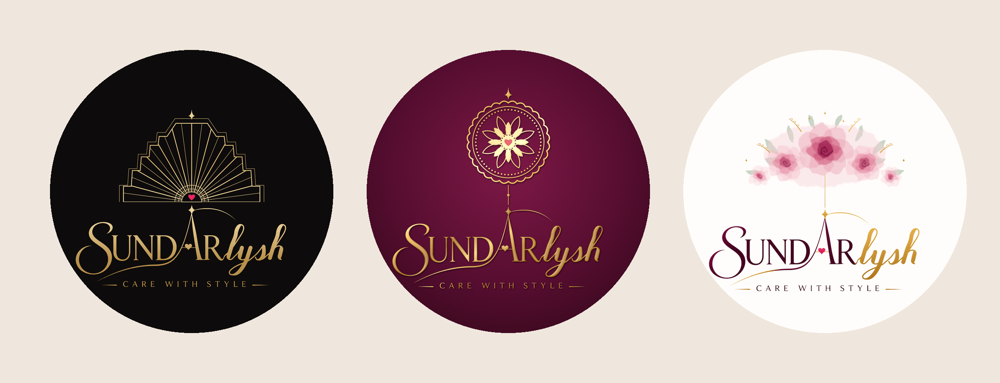

# Sundarlysh: Completely New Styles (v10)

The original lettering stays, but the whole visual style changes in each design.

| # | Style | Look |
|---|-------|------|
| 31 | **Art Deco** | Black and champagne gold. A geometric sunrise of rays rises from the A's star inside a stepped ziggurat arch, in a 1920s luxury style. The whole name is in champagne gold. |
| 32 | **Gold Foil on Velvet** | Deep wine velvet texture. A lotus-mandala medallion and the whole name are embossed in gold foil (raised, catching the light), joined by a thread to the A's star. |
| 33 | **Watercolour Bloom** | Hand-painted blush and wine roses with sage leaves arch over the name, with fine gold sprigs and stars. It's soft, feminine and fresh. |

SVG and 2160px PNG.
