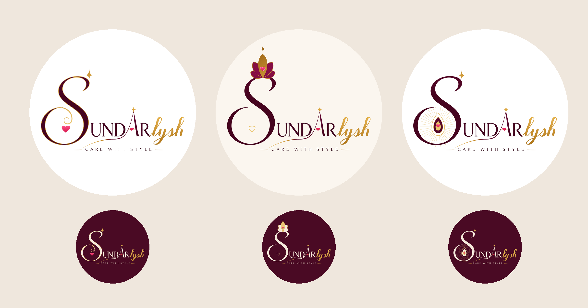

# Sundarlysh: The S Is the Logo (v11)

The **first letter S** of the name becomes the logo, inside the word itself.
It's the original swash S, enlarged about 2.5 times and decorated as an emblem.
The original "UND", the star-A with its gold thread, and "Rlysh" follow it
unchanged.

| # | Logo | The S |
|---|------|-------|
| 34 | **Jewel S** | An engraved gold line runs inside the S, the brand star sits on its hook, and a gold filigree curl and a pink heart nest in its lower bowl. |
| 35 | **Lotus S** | A wine-and-gold lotus with a heart blooms on the crown of the S, topped by a star. A fine gold heart rests in the bowl. |
| 36 | **Peacock S** | The lower bowl of the S becomes the eye of a peacock feather, with gold barbs radiating and a heart at the centre. The star sits on the S's hook. |

Light and dark versions, as SVG and 2160px PNG.
