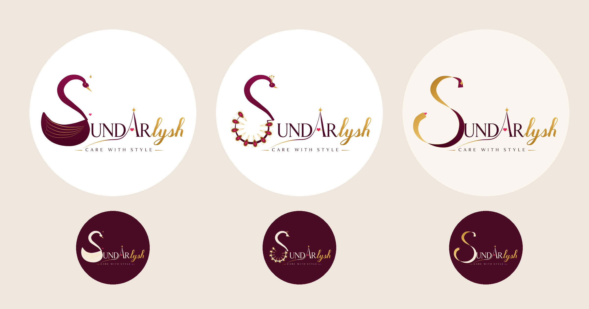

# Sundarlysh: The S Turns Into the Logo (v12)

Nothing is added before or around the S. **The S itself is redrawn so its own
shape becomes the picture.** The rest of the name ("UND", the star-A with its
thread, "Rlysh", and the tagline) is the original lettering, unchanged.

| # | Logo | How the S becomes the picture |
|---|------|-------------------------------|
| 37 | **Swan S** | The S's top hook is the swan's head, with a gold beak and eye. The spine is its neck, and the lower curve is its body, with engraved gold wing feathers. |
| 38 | **Peacock S** | The hook is a peacock's crested head, and the S's lower curve fans out into tail feathers with jewelled eyes. |
| 39 | **Silk Ribbon S** | The S is a twisting silk ribbon, gold on one side and wine on the other, that ends in a pink heart. |

Light and dark versions, as SVG and 2160px PNG.
