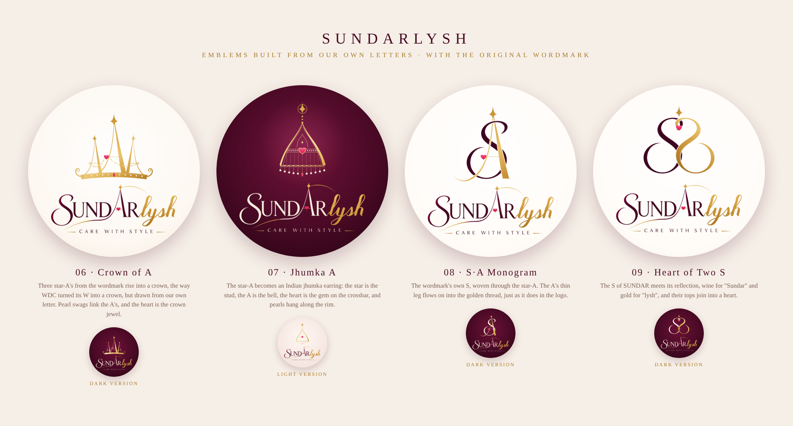

# Sundarlysh: Letter-Linked Emblems (v2)



Feedback on v1: keep **the same text**, keep the creativity of the **A**, and
make the emblem **link to the text**, the way The Wedding Design Company
turned its **W** into a crown.

So every emblem here is built from a letter of **SUNDAR**, and every design
uses the client's **exact original wordmark** underneath.

| # | Emblem | Built from | Idea |
|---|--------|-----------|------|
| 06 | **Crown of A** | the star-A | Three star-A's rise into a *mukut* (crown), our answer to the crowned W. Pearl swags tie the A's together, and the heart on the centre A is the crown jewel. A pink gem sits in the band. |
| 07 | **Jhumka A** | the star-A | The A becomes an Indian **jhumka earring**: the brand star is the stud, the A is the bell, the heart is the gem on the crossbar, and pearls hang from the scalloped rim. |
| 08 | **S·A Monogram** | the S + the star-A | The wordmark's own **S** (traced from the logo) woven over and under the star-A. The A's thin leg sweeps on into the **golden thread**, exactly as it does in the logo. |
| 09 | **Heart of Two S** | the S | The S of SUNDAR meets its own reflection: **wine for "Sundar", gold for "lysh"**. Their tops join into a **heart**, with the brand star above. |

Each concept comes in two versions (light and dark). On dark backgrounds the
wine lettering of the wordmark turns ivory, and the gold and pink stay as they
are.

## Files

```
svg/  06-crown-of-a(.svg | -dark.svg), 07-jhumka-a(.svg | -light.svg),
      08-sa-monogram(.svg | -dark.svg), 09-heart-of-two-s(.svg | -dark.svg)
png/  the same set at 2160×2160 (ready for an Instagram / WhatsApp DP)
sundarlysh-v2-board.png   presentation board
src/  generator (Node) + trace/ (wordmark tracing scripts and data)
```

## About the wordmark

The "SUNDARlysh / CARE WITH STYLE" lettering is **the client's original
artwork**, not retyped. It was traced to smooth vector outlines with potrace.
Its colours (including the gold-to-wine blend in the thread and in R→l) come
from a smooth colour map of the original. Edges stay crisp at any size, and the
colours match the original logo exactly.

All four designs keep their content inside the centre circle, so nothing is
cut off by circular profile-picture crops.

## Regenerate

```bash
cd src && npm i opentype.js@1.3.4 svgpath@2.6.0 playwright @fontsource/cinzel
node build2.js        # writes out2/*.svg
node render.js out2 2 out2/*.svg
```
