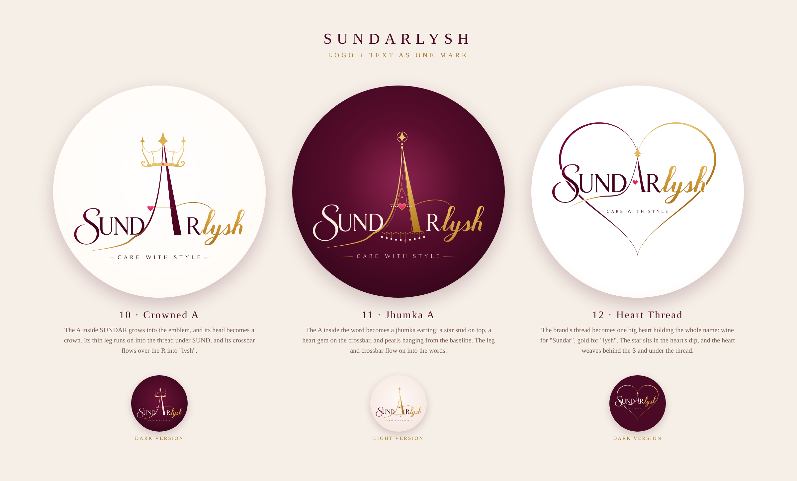

# Sundarlysh: Logo + Text as One Mark (v3)



Feedback on v2: the logo and the text should **merge into one piece**. The
emblem should not sit above the words; it should be attached to and woven
into them. That is exactly how the original logo treats its **A**, so v3
pushes that idea further.

| # | Lockup | How logo and text merge |
|---|--------|-------------------------|
| 10 | **Crowned A** | The **A of SUNDAR** grows tall and becomes the emblem, and its head turns into a crown with spires, pearls and a ruby, like WDC's crowned W. Its thin leg runs on as the **gold thread under SUND**. Its **crossbar (with the heart) flows over the R into the "l" of lysh**. |
| 11 | **Jhumka A** | The **A of SUNDAR** becomes a jhumka earring: a star stud, a bell with a heart gem on a beaded crossbar, and a **pearl fringe hanging from the baseline of the word**. The leg and the crossbar flow into the text the same way. |
| 12 | **Heart Thread** | The brand thread becomes **one big heart holding the whole name**, with the star of the A in the heart's dip. The left lobe is **wine (Sundar)** and the right lobe is **gold (lysh)**. The heart passes **behind the swash S** and under the swoosh, so the heart and the letters are woven together. |

Each lockup comes in two versions (light and dark). On dark backgrounds the
wine letters turn ivory, and the gold and pink stay as they are.

## Files

```
svg/  10-crowned-a-lockup(.svg | -dark.svg)
      11-jhumka-a-lockup(.svg | -light.svg)
      12-heart-thread-lockup(.svg | -dark.svg)
png/  the same set at 2160×2160 (Instagram / WhatsApp DP ready)
sundarlysh-v3-board.png
src/  generator + trace/ (wordmark split into SUND / A+thread / Rlysh / tagline)
```

* The letters are the **client's original artwork**. The wordmark was traced
  to vector and split into parts (SUND · A with its thread · Rlysh · tagline),
  so the letters could be rebuilt around the new emblems without retyping
  anything.
* Everything stays inside the centre circle, so profile-picture crops never
  cut it.

## Regenerate

```bash
cd src && npm i opentype.js@1.3.4 svgpath@2.6.0 playwright
node build3.js                 # writes out3/*.svg
node render.js out3 2 out3/*.svg
```
