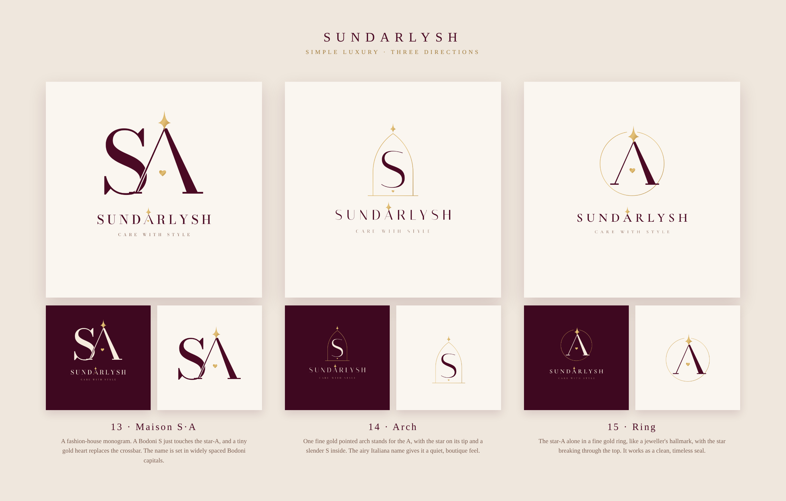

# Sundarlysh: Simple Luxury (v4)

A fresh start in a **simple-luxury** style: clean and minimal, like a
high-end fashion house. The colours are wine, ivory and one gold accent. The
only signature carried over is the brand's **star-A**, with a tiny gold
**heart in place of its crossbar**.

| # | Direction | Mark | Name |
|---|-----------|------|------|
| 13 | **Maison S·A** | A Bodoni **S** that just touches a Didone **star-A**, in the spirit of a fashion-house monogram. | Bodoni capitals, widely spaced, with the star-A in the name |
| 14 | **Arch** | One fine gold **pointed arch** (the A) with the star on its tip and a slender Italiana **S** inside. | Airy Italiana capitals, with a star on the A |
| 15 | **Ring** | The **star-A alone in a fine gold ring**, like a jeweller's hallmark. The star breaks through the top of the ring. | Cormorant capitals, with a star on the A |

Each direction includes: the logo (light, dark, transparent) and the mark
alone (light, dark), as SVG and 2160px PNG.
