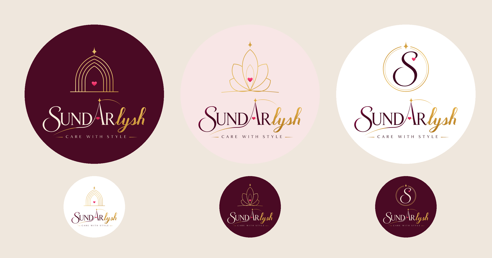

# Sundarlysh: Symbol + Original Wordmark (v5)

The original **SUNDARlysh / CARE WITH STYLE** lettering is kept exactly (traced
from the client's artwork). A new symbol sits above it, in the same format as
the reference accounts:

* one simple symbol, centred above the name
* clean gold outlines and nested lines
* a meaning tied to the brand
* a single solid background colour

| # | Symbol | Meaning |
|---|--------|---------|
| 16 | **Star Arch** | Nested pointed arches, each one the shape of the brand's A. The star sits on top and the pink heart at the doorway. |
| 17 | **Sundar Lotus** | A lotus (beauty) whose petals are pointed arches, the A shape again. A heart sits at its centre and the star above it. |
| 18 | **S Seal** | The swash **S** from the wordmark inside a fine double gold ring, with the star breaking through the top and a heart beside the S. |

Each comes in a light and a dark version, as SVG and 2160px PNG, ready for a
circular profile picture.
