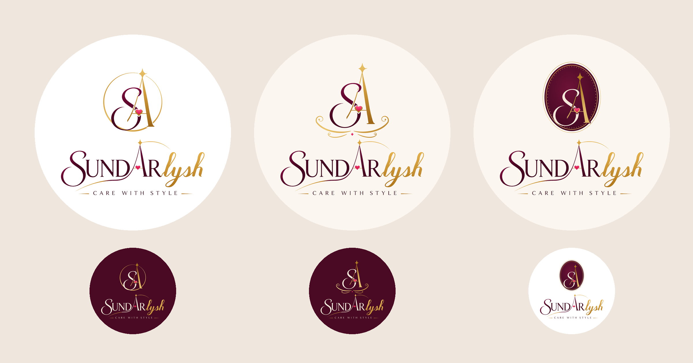

# Sundarlysh: Monogram Crests (v6)

The symbol is now drawn **in the same style as the wordmark**, using the
wordmark's own letters: the original **swash S** (wine, like "SUNDAR") woven
with the original **star-A** (gold, like "lysh"), with the pink heart on the
A's crossbar. The original wordmark sits underneath, so the symbol and the text
share one style.

| # | Crest | Frame |
|---|-------|-------|
| 19 | **Thread Seal** | The gold thread leaves the A's star and circles the monogram, thick and thin like a pen stroke. The S breaks through the ring. |
| 20 | **Flourish Crest** | Classic calligraphic gold swashes cradle the monogram, with a small pink gem at the centre. |
| 21 | **Wine Medallion** | The monogram in ivory and gold on a wine oval with a beaded gold border, like a foil stamp or wax seal. |

Light and dark versions, as SVG and 2160px PNG.
