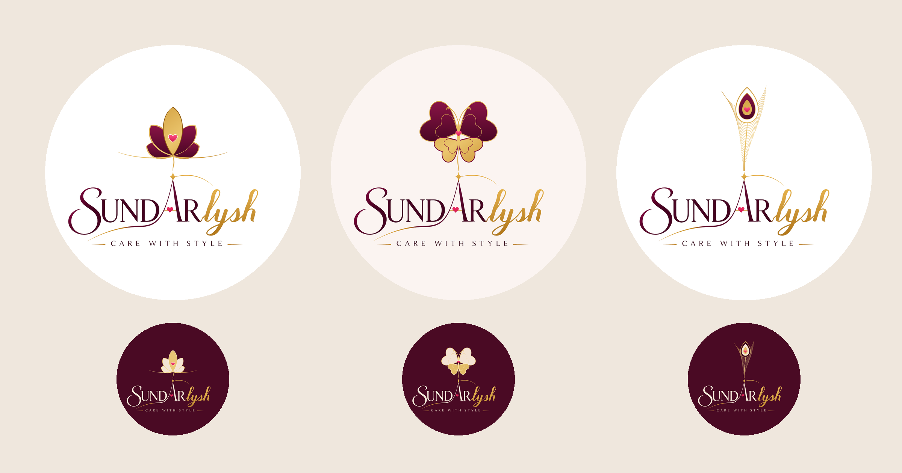

# Sundarlysh: Symbol Grows From the Text (v7)

No letters are used as the logo. Each symbol is a **picture**, physically
**attached to the original wordmark**. In the wordmark, the gold thread starts
at the star of the A, and here that same thread rises from the star and grows
into the symbol. The logo and the text are one continuous piece, drawn in the
wordmark's own wine, gold and pink calligraphic style.

| # | Symbol | Meaning |
|---|--------|---------|
| 22 | **Lotus** | Beauty. A wine-and-gold lotus blooms on a thread stem from the A's star, with a heart at its centre and a gold waterline. |
| 23 | **Butterfly** | Grace and transformation. Its wings are hearts (care): wine on top and gold below. It has landed on the star. |
| 24 | **Peacock Feather** | Indian elegance and style. The feather's shaft rises from the star, and its eye holds the pink heart. |

Light and dark versions, as SVG and 2160px PNG.
