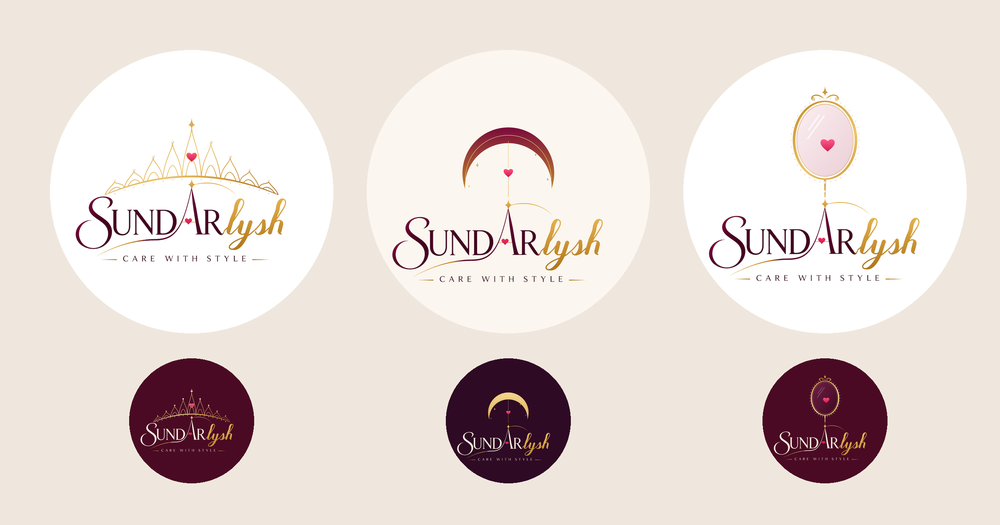

# Sundarlysh: Tiara · Moon & Star · Vanity Mirror (v8)

Three new picture symbols, each joined to the **star of the A** in the original
wordmark.

| # | Symbol | How it connects |
|---|--------|-----------------|
| 25 | **Tiara** | A royal tiara arches over the whole name, and its centre jewel (the pink heart) rests on the A's star, so the brand wears the crown. |
| 26 | **Moon & Star** | A wine-to-gold crescent arches over the A. A heart hangs from the moon on a gold thread that runs down into the A's star. |
| 27 | **Vanity Mirror** | An ornate oval beauty mirror. Its handle is the gold thread rising from the star, and the reflection is a heart: care with style. |

Light and dark versions, as SVG and 2160px PNG.
