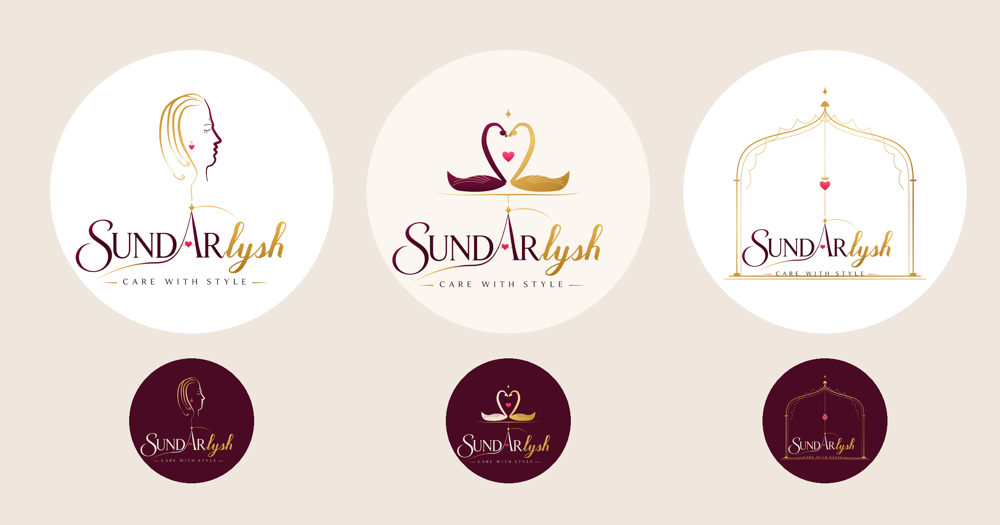

# Sundarlysh: Sundari · Swan Heart · Jharokha Frame (v9)

Three new picture symbols, each connected to the original wordmark.

| # | Symbol | Idea |
|---|--------|------|
| 28 | **Sundari** | A calligraphic woman's profile in wine, with a gold star bindi and a heart jhumka. Her flowing gold hair runs down into the A's star. |
| 29 | **Swan Heart** | Two swans, wine (Sundar) and gold (lysh), whose necks form a heart. They glide on the gold thread, which drops into the A's star. |
| 30 | **Jharokha Frame** | A palace window frames the whole name, and a heart lantern hangs from the arch's crown down to the A's star. |

Light and dark versions, as SVG and 2160px PNG.
