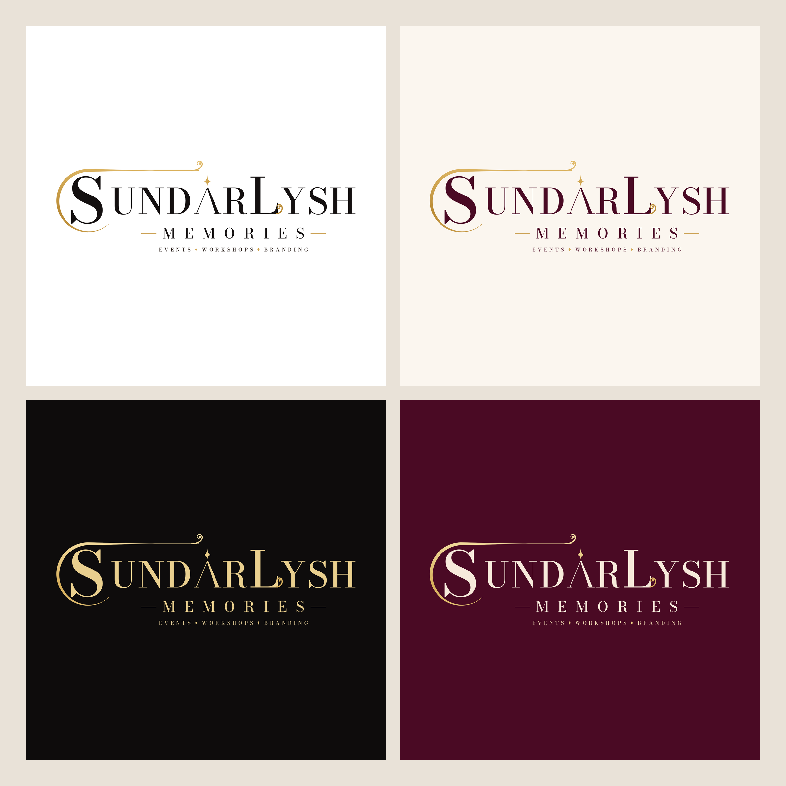

# SUNDARLYSH MEMORIES

A refined version of the client's **SUNDARLYSH MOMENTS** logo, renamed
**SUNDARLYSH MEMORIES** (Events · Workshops · Branding).

What was kept from the original:
* the big **S** wrapped in a swash that runs on as a line over the name and
  ends in a curl
* the crossbar-less **A**
* the tall **L** with a curled foot
* the stacked name / sub-name / services layout

What was improved:
* One consistent high-contrast **Bodoni** (Didone) face, so the thick and thin
  strokes and the spacing match across the whole name.
* The swash is now a smooth **calligraphic gold stroke**, thick on the left
  and fine at its ends, finishing in a pearl-tipped curl.
* A **gold star** crowns the A (the spark of a memory), and the L's curl is in
  gold to match.
* **MEMORIES** is evenly spaced between fine gold rules, and the services line
  is separated by small gold diamonds.

## Files

| File | Use |
|------|-----|
| `png/memories-classic.png` | Black and gold on white (closest to the original) |
| `png/memories-wine.png` | Wine and gold on ivory |
| `png/memories-noir.png` | Gold on black |
| `png/memories-royal.png` | Ivory and gold on wine |
| `png/memories-wide-black.png`, `png/memories-wide-wine.png` | Transparent wide logos for websites, cards and print |
| `svg/` | Vector versions of everything |

Square PNGs are 2160×2160.
