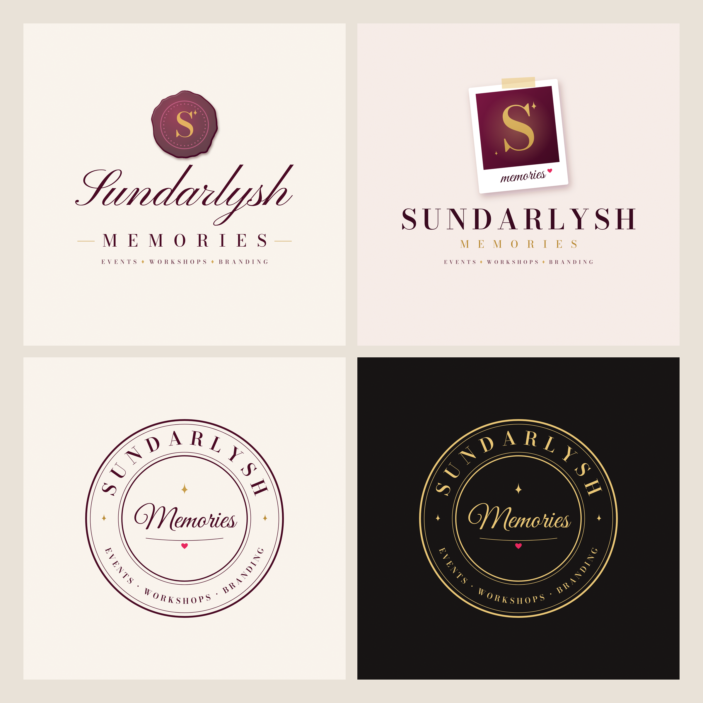
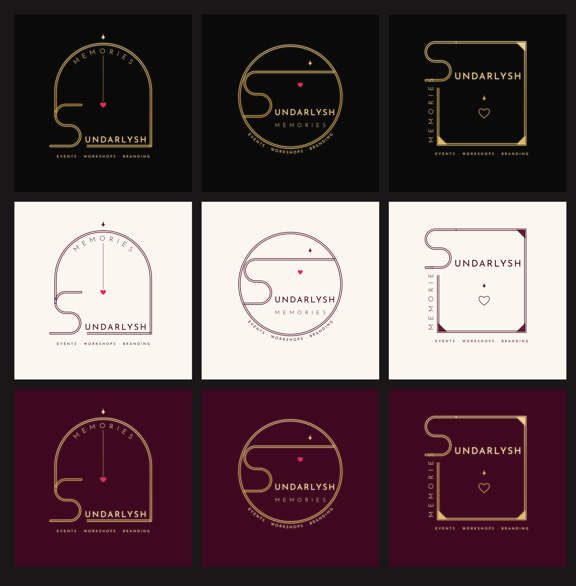

# SUNDARLYSH MEMORIES

A refined version of the client's **SUNDARLYSH MOMENTS** logo, renamed
**SUNDARLYSH MEMORIES** (Events · Workshops · Branding).

What was kept from the original:
* the big **S** wrapped in a swash that runs on as a line over the name and
  ends in a curl
* the crossbar-less **A**
* the tall **L** with a curled foot
* the stacked name / sub-name / services layout

What was improved:
* One consistent high-contrast **Bodoni** (Didone) face, so the thick and thin
  strokes and the spacing match across the whole name.
* The swash is now a smooth **calligraphic gold stroke**, thick on the left
  and fine at its ends, finishing in a pearl-tipped curl.
* A **gold star** crowns the A (the spark of a memory), and the L's curl is in
  gold to match.
* **MEMORIES** is evenly spaced between fine gold rules, and the services line
  is separated by small gold diamonds.

## Files

| File | Use |
|------|-----|
| `png/memories-classic.png` | Black and gold on white (closest to the original) |
| `png/memories-wine.png` | Wine and gold on ivory |
| `png/memories-noir.png` | Gold on black |
| `png/memories-royal.png` | Ivory and gold on wine |
| `png/memories-wide-black.png`, `png/memories-wide-wine.png` | Transparent wide logos for websites, cards and print |
| `svg/` | Vector versions of everything |

Square PNGs are 2160×2160.

---

## More styles

| File | Style |
|------|-------|
| `png/memories-wax-seal.png` | **Wax Seal:** "Sundarlysh" in flowing script under a wine wax seal stamped with a gold S and star, like a luxury event invitation. |
| `png/memories-polaroid.png` | **Polaroid:** a tilted instant photo holding a gold S, with "memories ♥" handwritten on the caption strip and a strip of washi tape; the name is in Bodoni capitals below. |
| `png/memories-heritage-stamp.png` / `-dark.png` | **Heritage Stamp:** a round seal with SUNDARLYSH and the services curving around the ring and "Memories" in script at the centre, in wine on ivory or gold on black. |

---

## Line-frame styles (the letter becomes the frame)

Inspired by the *principles* of a reference logo, not its layout:
* one fine double-line drawing in which the **S's own strokes turn into the frame**
* the name continuing from the S
* **MEMORIES** set along the frame
* light, widely spaced geometric capitals (Josefin Sans)
* a glowing line on dark backgrounds

| Files | Concept |
|-------|---------|
| `png/memories-arch-door-{noir,ivory,wine}.png` | **Arch Door:** the left side of an Indian arched doorway runs down into the S, UNDARLYSH continues along the threshold, MEMORIES curves under the crown, and a heart hangs from the star at the top. |
| `png/memories-ring-{noir,ivory,wine}.png` | **Ring:** the S's top and bottom strokes stretch out until they meet a ring, so the letter and the ring are one drawing. The services curve around the bottom. |
| `png/memories-photo-frame-{noir,ivory,wine}.png` | **Photo Frame:** the S's top stroke becomes a photo frame with mounting corners, and MEMORIES rises up the left edge like a caption written on the back of a photo. |
